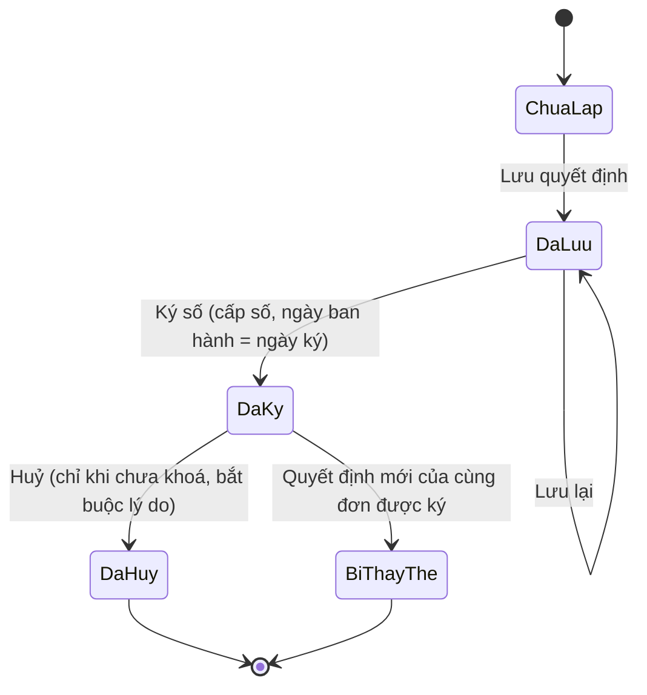

# TÀI LIỆU ĐẶC TẢ YÊU CẦU PHẦN MỀM (SRS)
## CHỨC NĂNG: TẠO QUYẾT ĐỊNH PHÂN CÔNG THẨM PHÁN (MH-PCTP-QĐ)

**Phạm vi**: TAND cấp tỉnh — màn Phân công thẩm phán, tab **Quản lý kết quả phân công**. TANDTC **không** có chức năng này.
**Phiên bản**: 1.6 — 28/09/2026
**Bản demo tham chiếu** (demo làm theo bản 1.0, chưa có các thay đổi từ bản 1.1 — xem mục 10):
- Nút bấm: `app/components/PhanCong3 soides gồm hhamPhanScreen.tsx` (prop `onTaoQuyetDinh`)
- Popup: `app/tinh/QuyetDinhPhanCong.tsx`
- Gắn vào màn: `app/tinh/PhanCongThamPhanView.tsx`
- Biểu mẫu A4: `app/tinh/components/DocumentNumberingModal.tsx` (`ToTrinhPhanCongPreview`, nhánh `quyetDinh`)
- Đồng bộ kho văn bản: `app/tinh/components/QuanLyVanBan.tsx` (`taoQuyetDinhPhanCong`), `app/tinh/AppTinh.tsx` (`dongBoQDPhanCong`)

| Phiên bản | Ngày | Nội dung |
|---|---|---|
| 1.0 | 28/09/2026 | Bản đầu, mô tả theo demo. |
| 1.1 | 28/09/2026 | Chốt với nghiệp vụ: **Chánh án** lập và ký ngay trong popup, luồng ký một bước, không có trả lại. Bỏ bước Gửi trình ký / Chờ ký; gộp Huỷ ký số và Dừng thành **Huỷ**. Chỉ huỷ được khi chưa thoát popup; sau đó muốn đổi thì **lập quyết định mới** (bản ghi mới, cùng mẫu), quyết định cũ giữ lại. Ngày ban hành = ngày ký thực tế. Số chính thức `{số}/{năm}/QĐ-CA`. Thêm xử lý lỗi, tiêu chí nghiệm thu, vấn đề mở. |
| 1.2 | 28/09/2026 | Chốt VĐ-06: Ghi chú **không** in lên văn bản. Chốt VĐ-08: ở cấp tỉnh, màn Phân công thẩm phán chỉ dành cho **Chánh án và Phó Chánh án**; Phó Chánh án được ký thay (**KT. CHÁNH ÁN**). |
| 1.3 | 28/09/2026 | Chưa có mẫu quyết định: tách mục 6 thành phần đã chốt (xem/in, dữ liệu cấp cho mẫu, quy tắc hiển thị) và phần **pending** (bố cục, câu chữ). Các chỗ phụ thuộc mẫu đánh dấu ⏸ pending. |
| 1.4 | 28/09/2026 | Ký hiệu số chính thức đổi thành `QĐ-TA`. Chốt VĐ-01, 03, 04, 05 theo đề xuất. Thêm VĐ-09 (cách ký số). Người khác thấy quyết định vừa ký như đã khoá (mục 3.4). |
| 1.5 | 28/09/2026 | Hai phương thức ký: Ký số (USB token) và Ký logic (mục 3.5). Thêm lỗi, tiêu chí nghiệm thu cho ký; VĐ-10 về chi tiết tích hợp. |
| 1.6 | 28/09/2026 | Phương thức ký theo cách ký đang có của hệ thống: hai nút **Ký số** / **Ký logic**, dùng lại hộp thoại Ký số văn bản. Chốt VĐ-10. |

---

### 1. Giới thiệu và Mục đích sử dụng

Sau khi đơn đã được phân công thẩm phán, TAND cấp tỉnh phải ban hành **Quyết định phân công thẩm phán giải quyết vụ án**. Chức năng này cho **Chánh án** (hoặc **Phó Chánh án** ký thay):
- Lập quyết định cho một hoặc nhiều đơn đã phân công — **mỗi quyết định gắn với một đơn**.
- Lưu dự thảo, **ký số ngay trong popup** (hệ thống cấp số khi ký), huỷ nếu vừa ký nhầm.
- Lập quyết định mới thay cho quyết định đã ký khi cần đổi (ví dụ đổi thẩm phán).
- Xem và in biểu mẫu quyết định, mở quyết định trong màn Danh sách văn bản.

---

### 2. Nút "Tạo Quyết định phân công"

#### 2.1. Vị trí và điều kiện hiển thị
- Màn **Phân công thẩm phán**, tab **Quản lý kết quả phân công**, thanh thao tác phía trên bảng.
- Chỉ hiện ở **TAND cấp tỉnh**. Ở cấp tỉnh, cả màn Phân công thẩm phán chỉ dành cho **Chánh án** và **Phó Chánh án** (mục 8). Màn dùng chung với TANDTC; ở TANDTC không truyền `onTaoQuyetDinh` nên nút không hiện.
- Nhãn nút:
  - Chưa tick dòng nào: **Tạo Quyết định phân công**
  - Có tick: **Tạo Quyết định phân công (N đơn đã chọn)** — N là số dòng đang tick.

#### 2.2. Tập đơn đưa vào popup
1. Có tick dòng: lấy các dòng đang tick **và đã có thẩm phán**.
2. Không tick dòng nào: lấy **toàn bộ** đơn theo bộ lọc của tab (mọi trang, không chỉ trang đang xem) **và đã có thẩm phán**.
3. Đơn đã có quyết định (ở bất kỳ trạng thái nào) **vẫn** được đưa vào, để xem, ký tiếp hoặc lập quyết định mới.
4. Nếu tập rỗng: hiện hộp thông báo **"Chưa có kết quả phân công"** và không mở popup:
   - Có tick: *"Các đơn đang tick chưa có thẩm phán được phân công nên chưa thể tạo quyết định."*
   - Không tick: *"Chưa có đơn nào được phân công thẩm phán nên chưa thể tạo quyết định."*
5. Ngược lại: mở popup **Tạo quyết định phân công thẩm phán** (mục 3).

---

### 3. Popup "Tạo quyết định phân công thẩm phán"

#### 3.1. Bố cục
- Popup giữa màn hình. Đóng bằng nút **X** hoặc bấm ra ngoài — xem mục 3.4 về cảnh báo khi đóng.
- **Header**: tiêu đề *"Tạo quyết định phân công thẩm phán"*, dòng phụ *"Mỗi quyết định gắn với một đơn · {n} đơn đã phân công"*. Nếu có đơn tick bị bỏ qua vì chưa có thẩm phán, thêm *" · bỏ qua {m} đơn chưa có thẩm phán"*.
- **Cột trái — Danh sách đơn ({n})**. Mỗi dòng: số thụ lý (đậm), người đứng đơn, nhãn trạng thái của **quyết định mới nhất** của đơn (mục 4). Đơn Đã ký mà đã khoá có thêm biểu tượng khoá. Bấm một dòng để chọn đơn đang làm việc; mặc định chọn đơn đầu tiên.
- **Cột phải — Form quyết định** của đơn đang chọn (mục 3.2) và các nút thao tác (mục 3.3).
- Nếu tập đơn rỗng: vùng phải hiện *"Không có đơn nào đã được phân công thẩm phán."*

#### 3.2. Các trường của form

| Trường | Nguồn | Sửa được | Ghi chú |
|---|---|---|---|
| Số quyết định | Hệ thống | Không | Trước khi ký: hiện **"Dự thảo"** (không có số — BR-01). Sau khi ký: **số chính thức** (mục 5) |
| Ngày ban hành | Hệ thống | Không | Trước khi ký: hiện *"Lấy theo ngày ký"*. Sau khi ký: **ngày ký thực tế** theo giờ máy chủ (GMT+7), `DD/MM/YYYY` |
| Đơn vị soạn thảo | Mặc định tên tòa của người đăng nhập | Có | Vị trí in theo mẫu (mục 6.4, pending) |
| Số thụ lý | Đơn | Không | |
| Loại án | Đơn | Không | |
| Thẩm phán được phân công * | Kết quả phân công | Không | Trước khi ký: luôn lấy **thẩm phán hiện tại** của đơn. Khi ký: chốt vào quyết định, sau đó không đổi theo phân công nữa. Muốn đổi thẩm phán thì sửa phân công ở bảng, không sửa ở đây |
| Lý do phân công | Kết quả phân công | Không | Chốt lúc ký như trên |
| Ghi chú | Người dùng nhập | Có | Không bắt buộc. Ghi chú **nội bộ**: **không** in lên biểu mẫu, chỉ lưu kèm bản ghi và hiện khi xem văn bản trong hệ thống |

Các trường **Đơn vị soạn thảo**, **Ghi chú** chỉ sửa được khi quyết định ở trạng thái **Chưa lập** hoặc **Đã lưu**. Từ **Đã ký** trở đi, form chỉ đọc.

Nếu quyết định đang **Đã ký** mà thẩm phán hiện tại của đơn đã khác thẩm phán trong quyết định, hiện cảnh báo vàng ở đầu form: *"Thẩm phán hiện tại ({tên}) khác với quyết định {số} ({tên cũ}). Lập quyết định mới để cập nhật."*

#### 3.3. Nút thao tác
Nút chính thay đổi theo trạng thái của quyết định đang chọn:

| Trạng thái hiện tại | Nút hiện | Kết quả |
|---|---|---|
| Chưa lập | **Lưu quyết định** | → Đã lưu. Thông báo *"Đã lưu dự thảo quyết định cho đơn {số thụ lý}."* |
| Đã lưu | **Lưu quyết định** (khi có thay đổi), **Ký số** và **Ký logic** | Lưu: ghi đè dự thảo, giữ trạng thái Đã lưu. Ký số / Ký logic (mục 3.5): lưu các thay đổi chưa lưu, cấp số chính thức, ngày ban hành = ngày ký → **Đã ký**. Trong lúc chờ, nút hiện *"Đang ký..."* và bị khoá. Thông báo *"Đã ký quyết định {số}."* |
| Đã ký, **chưa khoá** | **Huỷ quyết định** | Mở hộp xác nhận, bắt buộc nhập **lý do huỷ** (không rỗng sau khi bỏ khoảng trắng). Xác nhận → **Đã huỷ**, số bị thu hồi. Thông báo (màu đỏ) *"Đã huỷ quyết định {số}. Số này bị thu hồi."* |
| Đã ký, **đã khoá** | **Lập quyết định mới** | Hộp xác nhận: *"Quyết định {số} vẫn có hiệu lực cho tới khi quyết định mới được ký."* Xác nhận → tạo quyết định mới ở trạng thái **Chưa lập** cho đơn này (mục 4.2) |
| Đã huỷ | **Lập quyết định mới** | Tạo quyết định mới ở trạng thái **Chưa lập** |

Hai nút phụ luôn hiện dưới nút chính:
- **Xem biểu mẫu** — mở biểu mẫu A4 (mục 6).
- **Danh sách văn bản** — đóng popup (áp dụng mục 3.4), mở màn Danh sách văn bản lọc theo số thụ lý của đơn.

Cả hai **chỉ bật khi quyết định đã có bản ghi** (mọi trạng thái trừ Chưa lập). Khi chưa lưu: nút xám, tooltip *"Phải lưu quyết định trước khi xem biểu mẫu"*, và dòng nhắc màu đỏ *"Phải lưu quyết định trước khi xem biểu mẫu."*

Hộp thông báo kết quả thao tác hiện ở đầu form, màu xanh lá (thành công) hoặc đỏ (huỷ, lỗi).

#### 3.4. Khoá quyết định khi thoát popup
- Quyết định **Đã ký** chỉ huỷ được **trong phiên popup đã ký nó**. Khi phiên popup kết thúc, mọi quyết định đã ký trong phiên bị **khoá**: không huỷ được nữa, muốn đổi thì lập quyết định mới.
- Phiên popup kết thúc khi: đóng popup (X, bấm ra ngoài), bấm **Danh sách văn bản** hoặc **Xem trong danh sách văn bản**, tải lại trang, đăng xuất, hết phiên đăng nhập. Mở **Xem biểu mẫu** rồi đóng lại **không** kết thúc phiên.
- Quyết định đã ký ở phiên trước thì mở popup lại vẫn là **đã khoá**, kể cả cùng người.
- Với **người khác** (ví dụ Chánh án mở popup trong lúc Phó Chánh án vừa ký và chưa thoát), quyết định đó hiện như **đã khoá**: không có nút Huỷ, chỉ có Lập quyết định mới.
- Trước khi thoát, nếu trong phiên có quyết định vừa ký, hiện hộp xác nhận: *"Có {k} quyết định vừa ký. Sau khi thoát, các quyết định này không huỷ được nữa. Thoát?"* (Với tải lại trang/đóng tab: dùng cảnh báo mặc định của trình duyệt.)
- Khoá phải do **server** quyết định (BR-06), không dựa vào việc trình duyệt báo đóng popup: nếu mất kết nối hoặc đóng trình duyệt, phiên hết hạn sau **15 phút** không hoạt động (cấu hình được).

#### 3.5. Phương thức ký
Theo cách ký **đang có** của hệ thống ở màn Danh sách văn bản (`QuanLyVanBan.tsx`: hộp thoại `HopThoaiKySo`, nút "Lưu và ký logic"): popup có **hai nút riêng**, **Ký số** và **Ký logic**. Người ký chọn bằng cách bấm nút, không có hộp chọn phương thức.

| | **Ký số** (USB token) | **Ký logic** (không cần USB) |
|---|---|---|
| Bản chất | Chữ ký số trên file văn bản bằng chứng thư số của người ký | Xác nhận trên hệ thống, không dùng chứng thư số; hệ thống ghi người ký, thời điểm |
| Cần | USB token + phần mềm ký trên máy người ký | Không cần thiết bị |
| Hộp thoại | Dùng lại hộp thoại **Ký số văn bản** của hệ thống: số và trích yếu; dòng *"Hệ thống sẽ tự cấp số chính thức {số sẽ cấp}. Nội dung khoá vĩnh viễn sau bước này."*; ô chọn **Chứng thư số** (các chứng thư trên USB token của người ký). Nút **Huỷ** / **Ký số**. Sau đó nhập PIN theo phần mềm ký | Dùng cùng hộp thoại, **bỏ ô Chứng thư số**, nút xác nhận là **Ký logic**. *(Khác màn Danh sách văn bản — ở đó Ký logic không có hộp thoại. Ở đây cần hộp thoại vì ký là cấp số, không đảo ngược.)* |

**Trình tự Ký số (USB token):**
1. Server kiểm tra quyền, trạng thái Đã lưu, rồi **giữ chỗ số** tiếp theo của sổ (tòa, năm) — sổ bị khoá cho tới khi bước này xong.
2. Server dựng file văn bản cuối cùng **đã có số và ngày ký**, gửi phần cần ký xuống phần mềm ký.
3. Người ký nhập PIN, token ký, phần mềm ký trả chữ ký về server.
4. Server kiểm tra chứng thư: còn hạn, chưa bị thu hồi, **đúng người đang đăng nhập**. Đạt thì gắn chữ ký vào file, chốt số → **Đã ký**.
5. Lỗi, người ký bấm huỷ, hoặc quá **2 phút** (cấu hình được) chưa có chữ ký: **trả lại chỗ số**, quyết định giữ Đã lưu. Số không bị tiêu (BR-04).

**Trình tự Ký logic:** xác nhận → server kiểm tra quyền, trạng thái → cấp số, ghi người ký và thời điểm, dựng file văn bản có số và ngày → **Đã ký**. Tất cả trong một giao dịch.

Sau khi ký, hai phương thức có **cùng** trạng thái, cùng quy tắc khoá, huỷ, thay thế. Quyết định lưu thêm **phương thức ký**; nếu Ký số thì lưu cả thông tin chứng thư (số serial, tổ chức cấp, chủ thể) và file đã ký.

---

### 4. Trạng thái quyết định

#### 4.1. Bảng trạng thái

| Mã | Nhãn | Màu nhãn | Trạng thái ở kho văn bản |
|---|---|---|---|
| `mo` | Chưa lập | Xám | (chưa có bản ghi) |
| `daLuu` | Đã lưu | Xanh dương | Nháp |
| `daKy` | Đã ký | Xanh lá | Đã ban hành |
| `daHuy` | Đã huỷ | Đỏ | Đã huỷ |
| `biThayThe` | Bị thay thế | Xám | Đã ban hành, kèm nhãn *"Bị thay thế bởi {số mới}"* |

"Đã khoá" không phải trạng thái riêng mà là thuộc tính của quyết định Đã ký (mục 3.4).

#### 4.2. Lập quyết định mới
- **Đã huỷ** và **Bị thay thế** là trạng thái cuối. Quyết định ở hai trạng thái này **không sửa, không ký lại**; bản ghi, số đã cấp và lịch sử được giữ nguyên.
- **Lập quyết định mới** tạo một **bản ghi mới**, cùng loại văn bản và **cùng mẫu** (mục 6), lấy dữ liệu hiện tại của đơn. Quyết định mới đi lại vòng đời từ đầu và được cấp số mới khi ký.
- Khi quyết định mới được ký, quyết định Đã ký trước đó của cùng đơn (nếu có) tự chuyển sang **Bị thay thế**, trong cùng giao dịch với việc ký.
- Mỗi đơn có tối đa **một** quyết định đang soạn (Chưa lập/Đã lưu). Bấm Lập quyết định mới khi đã có dự thảo thì mở dự thảo đó, không tạo thêm.
- Popup luôn hiện quyết định mới nhất của đơn. Các quyết định cũ xem ở màn Danh sách văn bản.

---

### 5. Quy tắc số quyết định

| Mã | Quy tắc |
|---|---|
| BR-01 | Trước khi ký, quyết định **không có số** (hiện "Dự thảo"). |
| BR-02 | **Số chính thức** chỉ cấp ở bước **Ký số**, dạng `{3 chữ số}/{năm}/QĐ-TA`, ví dụ `001/2026/QĐ-TA`. Ký hiệu `QĐ-TA` lưu dạng cấu hình, không viết cứng. |
| BR-03 | Số chính thức **liên tục và không trùng trong sổ quyết định của tòa theo năm**. Vì mọi tòa dùng chung ký hiệu, khoá duy nhất là **(tòa, năm, số)**, không phải chuỗi số. Backend cấp số bằng sequence hoặc transaction có khoá — không tính ở phía client. |
| BR-04 | Cấp số và ký là **một thao tác**: ký lỗi thì số không bị tiêu, số tiếp theo vẫn liên tục. |
| BR-05 | **Huỷ** thu hồi số đã cấp: số giữ trên bản ghi đã huỷ để tra cứu, **không cấp lại** cho quyết định khác; sổ số ghi nhận số bị huỷ. |

---

### 6. Biểu mẫu Quyết định (Xem biểu mẫu)

> **⏸ PENDING — chưa có mẫu quyết định chính thức (VĐ-07).** Mục 6.1 → 6.3 đã chốt, dev làm được. Mục 6.4 chờ mẫu; **không** làm theo bố cục của bản demo.

#### 6.1. Xem và in (đã chốt)
Mở dạng popup rộng 900px, trang A4 trên nền xám. Header có ba nút: **Xem trong danh sách văn bản**, **In**, **Đóng**. Khi in chỉ in trang A4, ẩn toàn bộ giao diện còn lại.

Biểu mẫu phải dựng từ **mẫu cấu hình được** (không viết cứng trong code), để khi có mẫu chính thức hoặc mẫu thay đổi chỉ cần cập nhật mẫu.

#### 6.2. Dữ liệu hệ thống cung cấp cho mẫu (đã chốt)

| Trường dữ liệu | Nguồn | Khi chưa ký |
|---|---|---|
| Tên tòa, địa danh của tòa | Tòa đang đăng nhập | Có |
| Đơn vị soạn thảo | Form | Có |
| Số quyết định | Cấp khi ký (mục 5) | Trống |
| Ngày ban hành | Ngày ký | Trống |
| Số thụ lý, ngày thụ lý, loại án | Đơn | Có |
| Người đứng đơn, số BA/QĐ | Đơn | Có |
| Thẩm phán được phân công | Kết quả phân công (chốt lúc ký) | Có |
| Người ký: họ tên, chức danh, có phải ký thay không | Người bấm Ký (chốt lúc ký) | Trống |
| Phương thức ký; thông tin chứng thư (nếu Ký số) | Mục 3.5 | Trống |
| Trạng thái quyết định | Mục 4 | Có |

Nếu mẫu chính thức cần thêm trường chưa có ở bảng này, bổ sung khi có mẫu.

#### 6.3. Quy tắc hiển thị không phụ thuộc mẫu (đã chốt)
- Trường **Ghi chú** không in lên biểu mẫu.
- Chưa ký: số và ngày ban hành để trống (dòng chấm hoặc tương đương theo mẫu), không có chữ ký.
- Khối ký theo **người ký thật**, chốt lúc ký — người khác mở lại biểu mẫu sau đó vẫn thấy đúng người đã ký:
  - Chánh án ký: chức danh Chánh án.
  - Phó Chánh án ký: thể hiện **ký thay** Chánh án (KT. CHÁNH ÁN).
  - Câu chữ chính xác của khối ký theo mẫu (6.4).
- Đã ký (kể cả Bị thay thế): có dấu hiệu đã ký. **Ký số** và **Ký logic** phải phân biệt được trên biểu mẫu (câu chữ theo mẫu, ví dụ "Đã ký số" / "Đã ký").
- Quyết định **Đã huỷ** và **Bị thay thế** phải nhìn là biết ngay trên biểu mẫu (cách thể hiện theo mẫu, ví dụ chữ in chìm).
- Quyết định lập mới (mục 4.2) dùng **đúng mẫu** như quyết định đầu, không thêm nội dung "thay thế quyết định số…".

#### 6.4. ⏸ Bố cục và câu chữ — PENDING
Chờ mẫu quyết định chính thức. Gồm:
- Bố cục trang, quốc hiệu, tiêu đề, trích yếu.
- Căn cứ pháp lý; có dòng "Theo đề nghị của…" hay không, lấy từ đâu.
- Nội dung các Điều.
- Nơi nhận.
- Câu chữ khối ký, cách ghi địa danh và ngày.
- Mẫu có khác nhau theo loại án không.

*Tham khảo (không phải yêu cầu):* bản demo đang dùng bố cục tạm ở `ToTrinhPhanCongPreview` nhánh `quyetDinh`: quốc hiệu, "QUYẾT ĐỊNH — Về việc phân công thẩm phán giải quyết vụ án", Điều 1 phân công, Điều 2 trách nhiệm, Điều 3 hiệu lực, Nơi nhận "Như Điều 3; Thẩm phán {tên}".

---

### 7. Kho văn bản (màn Danh sách văn bản)

Quyết định **chính là** một bản ghi văn bản trong kho văn bản chung — lưu một chỗ, không lưu ở popup rồi chép sang kho. Nhờ vậy nó hiện ở màn **Danh sách văn bản** và mở được bằng luồng xem văn bản sẵn có.

| Trường ở kho văn bản | Giá trị |
|---|---|
| Id bản ghi | Riêng cho **từng quyết định** (một đơn có thể có nhiều bản ghi qua các lần lập mới). Có khoá ngoại tới đơn |
| Trích yếu | *Quyết định phân công thẩm phán – {số thụ lý}* |
| Loại văn bản | Quyết định phân công thẩm phán |
| Số văn bản, trạng thái số | Trống khi dự thảo; số chính thức khi đã ký (giữ lại cả khi Đã huỷ/Bị thay thế) |
| Ngày ban hành | Ngày ký; trống khi chưa ký |
| Trạng thái | Theo bảng mục 4.1 |
| Luồng ký | **Một bước: Chánh án (hoặc Phó Chánh án ký thay) ký.** Không có bước duyệt, bút phê, trả lại |
| Phương thức ký, file đã ký | Ký số / Ký logic; với Ký số lưu file có chữ ký số và thông tin chứng thư (mục 3.5) |
| Nội dung | Dựng từ mẫu (mục 6) với dữ liệu mục 6.2. Từ lúc ký, nội dung **cố định** — mẫu đổi sau này không làm đổi quyết định đã ký. *Cách dựng nội dung: pending theo mẫu* |
| Lịch sử | **Ghi nối tiếp**, mỗi thao tác một mốc với người, thời điểm thật: Tạo, Lưu, Ký (kèm số và phương thức ký), Huỷ (kèm lý do, số thu hồi), Bị thay thế (kèm số quyết định mới) |
| Đơn đính kèm | Số thụ lý, người đứng đơn, số BA/QĐ, hình thức đơn |

---

### 8. Phân quyền và yêu cầu phi chức năng

| Thao tác | Chánh án (`TI-CA`) | Phó Chánh án (`TI-PCA`) | Các vai trò khác |
|---|---|---|---|
| Vào màn Phân công thẩm phán, thấy nút Tạo Quyết định phân công | Có | Có | Không — không có menu, server chặn |
| Lưu, Lập quyết định mới | Có | Có | Không |
| Ký (Ký số hoặc Ký logic) | Có — ký **CHÁNH ÁN** | Có — ký thay **KT. CHÁNH ÁN** | Không |
| Huỷ | Có | Có | Không |
| Xem quyết định ở màn Danh sách văn bản | Có | Có | Theo quyền xem văn bản chung |

- Huỷ chỉ làm được trong phiên popup đã ký (BR-06), nên trên thực tế chỉ **người vừa ký** huỷ được quyết định của mình.
- Dự thảo do một người lưu thì người kia vẫn mở, sửa và ký được (không khoá theo người lập).

- Mọi thao tác kiểm tra **quyền, trạng thái và khoá ở server**; ẩn/khoá nút ở giao diện chỉ là hiển thị.
- Trạng thái quyết định phải **lưu bền**: đóng popup rồi mở lại, hoặc tải lại trang, thì mỗi đơn vẫn hiện đúng quyết định mới nhất với trạng thái, số và thuộc tính khoá.
- Mọi đổi trạng thái ghi nhật ký: người, thời điểm, trạng thái trước/sau, số văn bản.

#### 8.1. Quy tắc nghiệp vụ bổ sung

| Mã | Quy tắc |
|---|---|
| BR-06 | Server giữ **phiên popup**: mỗi lần mở popup là một phiên có mã riêng. Chỉ huỷ được quyết định đã ký **trong đúng phiên đó** khi phiên còn hiệu lực. Phiên kết thúc khi client báo đóng, hoặc hết thời gian không hoạt động (VĐ-03). |
| BR-07 | Mỗi đơn có tối đa **một** quyết định **đang hiệu lực** (Đã ký, chưa bị thay thế) và tối đa **một** quyết định **đang soạn**. Số quyết định Đã huỷ/Bị thay thế không giới hạn. |
| BR-08 | **Xung đột**: mọi thao tác gửi kèm phiên bản bản ghi; nếu bản ghi đã bị thay đổi ở nơi khác thì từ chối và báo *"Quyết định đã được thay đổi ở nơi khác. Đang tải lại."*, rồi tải lại quyết định. |
| BR-09 | Thao tác **idempotent**: bấm Ký số hai lần (hoặc gửi lại do mạng) chỉ ký và cấp **một** số. |

#### 8.2. Xử lý lỗi

| Tình huống | Kết quả |
|---|---|
| Ký lỗi chung (mạng, server) — cả hai phương thức | Quyết định giữ **Đã lưu**, không cấp số. Thông báo đỏ *"Ký không thành công — quyết định chưa được cấp số. Vui lòng thử lại."* |
| Không tìm thấy phần mềm ký hoặc USB token | Như trên, thông báo *"Không tìm thấy USB token hoặc phần mềm ký. Kiểm tra thiết bị hoặc chọn Ký logic."* |
| Sai mã PIN | Do phần mềm ký báo; quyết định giữ Đã lưu |
| Chứng thư hết hạn, bị thu hồi, hoặc không đúng người đăng nhập | Server từ chối, giữ Đã lưu. Thông báo *"Chứng thư số không hợp lệ hoặc không phải của người ký."* |
| Người ký bấm huỷ ở phần mềm ký, hoặc quá thời gian chờ | Trả lại chỗ số, giữ Đã lưu. Thông báo *"Chưa ký — quyết định chưa được cấp số."* |
| Lưu lỗi | Giữ nguyên dữ liệu đang nhập trên form. Thông báo *"Lưu không thành công. Vui lòng thử lại."* |
| Huỷ lỗi | Quyết định giữ Đã ký. Thông báo *"Huỷ không thành công. Vui lòng thử lại."* |
| Huỷ khi quyết định đã khoá (ví dụ phiên đã hết hạn) | Server từ chối. Thông báo *"Quyết định đã khoá, không huỷ được. Hãy lập quyết định mới."* Form chuyển sang trạng thái đã khoá |

---

### 9. Tiêu chí nghiệm thu

| Mã | Cho trước | Khi | Thì |
|---|---|---|---|
| AC-01 | Vai trò không phải Chánh án/Phó Chánh án (ví dụ Trưởng phòng GĐKT, Thẩm phán) | Mở menu; gọi thẳng API màn Phân công thẩm phán, lưu/ký/huỷ | Không có menu Phân công thẩm phán; server từ chối, dữ liệu không đổi |
| AC-02 | Tick 3 đơn, 1 đơn chưa có thẩm phán | Bấm Tạo Quyết định phân công (3) | Popup có 2 đơn; header ghi "bỏ qua 1 đơn chưa có thẩm phán" |
| AC-03 | Đơn chưa có quyết định | Lưu | Trạng thái Đã lưu; số "Dự thảo"; ngày ban hành "Lấy theo ngày ký"; có bản ghi Nháp ở Danh sách văn bản |
| AC-04 | Quyết định Đã lưu | Ký số | Đã ký; số `{nnn}/{năm}/QĐ-TA` liên tục với số trước đó của tòa trong năm; ngày ban hành = hôm nay; form chỉ đọc; kho: Đã ban hành, lịch sử có mốc Ký số |
| AC-05 | Hai đơn Đã lưu | Ký lần lượt | Hai số khác nhau, liên tiếp |
| AC-06 | Tòa A và tòa B cùng ký quyết định đầu năm | — | Cả hai được `001/{năm}/QĐ-TA`, không báo trùng |
| AC-07 | Rút USB token giữa chừng / bấm huỷ ở phần mềm ký / để quá 2 phút | Ký số | Giữ Đã lưu, không cấp số; lần ký thành công kế tiếp nhận đúng số chưa dùng |
| AC-07a | Quyết định Đã lưu | Ký logic, xác nhận | Đã ký, có số; lịch sử ghi phương thức Ký logic; biểu mẫu hiện dấu hiệu Ký logic, khác Ký số |
| AC-07b | Người A đăng nhập, cắm token của người B | Ký số | Server từ chối vì chứng thư không đúng người; giữ Đã lưu |
| AC-07c | Hai người cùng bấm Ký số hai quyết định khác nhau cùng lúc | — | Hai số liên tiếp, không trùng, không nhảy số |
| AC-08 | Vừa ký trong phiên hiện tại | Huỷ, nhập lý do | Đã huỷ; số giữ trên bản ghi, đánh dấu thu hồi; quyết định ký sau đó nhận số **tiếp theo**, không dùng lại số đã huỷ |
| AC-09 | Vừa ký trong phiên hiện tại | Huỷ, để trống lý do | Nút xác nhận bị tắt |
| AC-10 | Vừa ký 1 quyết định | Bấm X | Hiện cảnh báo "Có 1 quyết định vừa ký…"; chọn Thoát thì đóng |
| AC-11 | Như AC-10, đã thoát | Mở lại popup | Quyết định Đã ký, có biểu tượng khoá; không có nút Huỷ; có nút Lập quyết định mới |
| AC-12 | Vừa ký trong phiên | Tải lại trang, mở lại popup | Như AC-11 |
| AC-13 | Quyết định đã khoá | Gọi thẳng API huỷ | Server từ chối |
| AC-14 | Quyết định đã khoá, đổi thẩm phán ở bảng phân công | Mở popup | Có cảnh báo thẩm phán khác; Lập quyết định mới → dự thảo mới có thẩm phán mới; quyết định cũ vẫn Đã ký |
| AC-15 | Như AC-14 | Ký quyết định mới | Quyết định mới Đã ký với số mới; quyết định cũ → Bị thay thế; Danh sách văn bản lọc theo số thụ lý có cả hai |
| AC-16 | Quyết định Đã huỷ | Lập quyết định mới, lưu, ký | Bản ghi mới, số mới; bản đã huỷ vẫn còn trong kho |
| AC-17 | Đơn đã có dự thảo | Bấm Lập quyết định mới (từ quyết định cũ đã khoá) | Mở dự thảo có sẵn, không tạo thêm |
| AC-18 | Bấm Ký số hai lần liên tiếp | — | Chỉ một số được cấp |
| AC-19 | Mở Xem biểu mẫu của quyết định Đã ký rồi đóng | Quay lại popup | Vẫn huỷ được (chưa kết thúc phiên) |
| AC-20 | Quyết định Đã huỷ | Xem biểu mẫu | Biểu mẫu thể hiện rõ là đã huỷ *(cách thể hiện: pending theo mẫu)* |
| AC-21 | Phó Chánh án đăng nhập, quyết định Đã lưu | Ký số | Đã ký; khối ký thể hiện Phó Chánh án ký thay Chánh án, đúng họ tên *(câu chữ: pending theo mẫu)*; lịch sử ghi đúng người, chức danh |
| AC-22 | Chánh án ký một quyết định | Phó Chánh án mở biểu mẫu quyết định đó | Khối ký vẫn là của Chánh án, đúng họ tên (đã chốt lúc ký) |
| AC-23 | Dự thảo có Ghi chú | Xem biểu mẫu, In | Ghi chú không xuất hiện trên trang A4 |

---

### 10. Khác biệt của bản demo — không mang sang bản thật

| # | Bản demo | Bản thật |
|---|---|---|
| 1 | Có bước **Gửi trình ký** và trạng thái **Chờ ký** | Bỏ. Đã lưu → Ký số trực tiếp (mục 3.3) |
| 2 | Có hai thao tác **Huỷ ký số** (từ Chờ ký) và **Dừng** (từ Đã ký); cả hai trả về số tạm rồi sửa tiếp trên cùng bản ghi | Một thao tác **Huỷ**, là trạng thái cuối; muốn đổi thì lập quyết định mới là bản ghi mới (mục 4.2) |
| 3 | Không có khoá khi thoát popup | Huỷ chỉ trong phiên popup (mục 3.4, BR-06) |
| 4 | Số tạm `QDTĐ{nnn}/2026` đánh lại từ 001 mỗi lần mở popup; số chính thức `…/QD-TAND-HN` đếm riêng từng đơn nên hai đơn có thể trùng số | Dự thảo không số; số chính thức theo BR-02 → BR-05 |
| 5 | Ngày ban hành chọn tay bằng DatePicker | Ngày ký thực tế, chỉ đọc |
| 6 | Form vẫn sửa được ngày, đơn vị, ghi chú ở mọi trạng thái | Chỉ đọc từ Đã ký |
| 7 | Trạng thái chỉ nằm trong popup: mở lại popup thì mọi đơn về "Chưa lập" | Đọc lại từ server (mục 8) |
| 8 | Quyết định lưu trong popup rồi chép sang kho văn bản; id bản ghi theo đơn (`vb-qd-{số thụ lý}`) nên luôn ghi đè | Quyết định chính là bản ghi trong kho; mỗi quyết định một id (mục 7) |
| 9 | Kho văn bản gắn luồng ký 3 bước (Trưởng phòng duyệt → Phó Chánh văn phòng ký → Phó Chánh án bút phê); lịch sử dựng lại toàn bộ mỗi lần đổi trạng thái, cùng một thời điểm | Luồng một bước Chánh án ký; lịch sử ghi nối tiếp |
| 10 | **Lỗi đồng bộ**: popup gửi sang kho dữ liệu **trước** khi cập nhật (`dongBo` trong `QuyetDinhPhanCong.tsx`). Sau Ký, kho ghi Đã ban hành nhưng số vẫn là số tạm; sau Dừng, kho ghi Đã huỷ nhưng vẫn giữ số chính thức | Không áp dụng khi dùng một chỗ lưu (mục 7) |
| 11 | Biểu mẫu cố định *"vụ án dân sự"*, *"Phòng Thẩm phán dân sự"*, địa danh *"Hà Nội"*; đơn vị soạn thảo mặc định *"Toà án nhân dân tỉnh Hà Nội"* | Theo mẫu chính thức (mục 6.4, pending); dữ liệu lấy theo đơn và tòa đang đăng nhập (mục 6.2) |
| 12 | Menu Phân công thẩm phán hiện với mọi vai trò cấp tỉnh trừ Chánh/Phó Chánh VP và cán bộ HCTP (`AppTinh.tsx`, sidebar) — tức cả Trưởng phòng, Phó trưởng phòng, CCNC GĐKT, Thẩm phán | Chỉ Chánh án và Phó Chánh án (mục 8) |
| 16 | Biểu mẫu in cố định *"CHÁNH ÁN"*; Ghi chú được in dưới Điều 3 | Chức danh theo người ký thật; Ghi chú không in (mục 6.3) |
| 13 | Header popup không cho biết đơn tick nào bị bỏ qua | Ghi "bỏ qua {m} đơn chưa có thẩm phán" (mục 3.1) |
| 14 | Nhãn trường viết sai *"Thẩm phân được phân công"* | *"Thẩm phán được phân công"* |
| 15 | Thông báo thành công màu xanh dương | Xanh lá (mục 3.3) |

---

### 11. Vấn đề mở

| Mã | Vấn đề | Đề xuất hiện tại |
|---|---|---|
| VĐ-01 | Dự thảo có cần số tạm không? | **Đã chốt (1.4):** không có số, hiện "Dự thảo" |
| VĐ-02 | Ký hiệu số chính thức | **Đã chốt (1.4):** `QĐ-TA` |
| VĐ-03 | Thời gian không hoạt động để phiên popup hết hạn (khi mất kết nối, đóng trình duyệt) | **Đã chốt (1.4):** 15 phút |
| VĐ-04 | Huỷ có bắt buộc lý do không? | **Đã chốt (1.4):** có |
| VĐ-05 | Trạng thái của quyết định bị thay thế trong kho văn bản | **Đã chốt (1.4):** Đã ban hành + nhãn "Bị thay thế bởi {số mới}" |
| VĐ-06 | Ghi chú nội bộ có được in lên văn bản chính thức không? | **Đã chốt (1.2):** không in |
| VĐ-07 | **Chưa có mẫu quyết định chính thức.** Chặn: mục 6.4, cách dựng nội dung ở kho (mục 7), câu chữ của AC-20, AC-21 | **Pending** — chờ nghiệp vụ cung cấp mẫu |
| VĐ-08 | Ai dùng màn Phân công thẩm phán; Phó Chánh án có được ký thay không? | **Đã chốt (1.2):** màn chỉ dành cho Chánh án và Phó Chánh án; Phó Chánh án ký thay (KT. CHÁNH ÁN) |
| VĐ-09 | Cách ký số | **Đã chốt (1.5):** hai phương thức — Ký số bằng USB token, hoặc Ký logic không cần USB (mục 3.5) |
| VĐ-10 | Chi tiết ký: (a) chọn phương thức thế nào; (b) tích hợp USB token; (c) Ký logic có cần xác thực lại; (d) thời gian chờ ký | **Đã chốt (1.6):** (a)(b)(c) **dùng lại cách ký đang có của hệ thống** (mục 3.5) — hai nút riêng, cùng cơ chế tích hợp USB token của màn Danh sách văn bản; (d) 2 phút |

---

### 12. Liên kết chéo

- Màn Phân công thẩm phán (tab, bảng, phân công ngẫu nhiên / chỉ định): `app/components/PhanCongThamPhanScreen.tsx`.
- Màn Danh sách văn bản: `app/tinh/components/QuanLyVanBan.tsx` (`taoQuyetDinhPhanCong`; luồng ký của quyết định cần tách khỏi `luongToTrinhPhanCong`).
